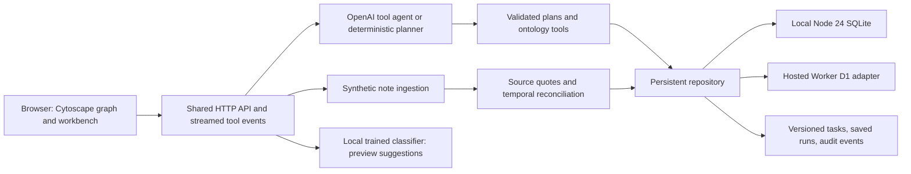

# Careweave

**Discover the reason care is missing. Trace the evidence. Prepare the next step.**

Careweave is a full-stack hackathon prototype for investigating diabetes care gaps across **1,000 fictional patients**. Its central interface is an interactive care graph: patients connect to diagnoses, overdue care, source documents, barriers, and potential interventions. A question becomes an exact SQL cohort, an inspectable evidence path, and a care-coordination draft that a human can review.

The memorable demo: find **82 patients** with overdue A1c tests and current transportation barriers, inspect Maya Bennett's source transcript, prepare a task, then add a fictional follow-up resolving her transportation problem. The same query now returns **81**, the graph changes, and the old task requires renewed evidence review. These counts apply to a fresh database with only that follow-up added.

Everything uses a fixed synthetic snapshot of **October 10, 2026**. No real patient information is needed or supported.

## New judge-facing tools

**Impact studio** answers the next question: what could the same limited resources support? Change the budget, outreach capacity, and available programs; compare a priority-first plan with a deterministic heuristic that favors complete support bundles. Each allocation links patient → source → barrier → intervention on an interactive graph. The comparison exposes the priority tradeoff: greater coverage can leave higher-priority patients waiting. Costs and capacities are illustrative, support is hypothetical, and the simulator neither changes records nor predicts health outcomes.

**Proof challenge** executes 14 manually curated adversarial cases against the actual extractor, runs the SQL cohort twice, and verifies quotations, ownership, and dates against authoritative document rows. Judges can enter their own fictional sentence and see the actual output. Expected versus observed results, failures, fingerprints, and exports are visible; this is a developer regression bench, not clinical validation.

The strongest demonstration combines these with the existing live-note workflow: add new evidence, watch the cohort and graph change, see an outdated approved task require renewed review, and rerun the resource plan using the changed data.

## Run locally

Requires **Node.js 24 or newer** and npm. The local database uses Node's built-in `node:sqlite` module; no separate database service is required.

```sh
npm install
npm start
```

Open [http://localhost:4173](http://localhost:4173). The first database request seeds `data/careweave.sqlite`; subsequent starts retain your notes, tasks, analysis runs, and audit events. Confirm that the sidebar says **Backend connected**, with **sqlite** storage. A disconnected static preview remains available, but it does not provide the full persistent workflow.

On a fresh dataset the graph contains **4,797 nodes and 6,632 edges**, backed by **3,000 source documents**. The population canvas displays a labeled sample for responsiveness; totals describe the full stored graph. Patient and cohort views show connected evidence relevant to their selection.

### GitHub and Visual Studio Code

Repository: [sadraaliproject/Hackathon-26](https://github.com/sadraaliproject/Hackathon-26).

After installing dependencies, open `Careweave.code-workspace` in VS Code. Press **F5** and choose **Careweave: Run and debug**. The debugger starts the Node server and opens the app. Stop another server using port 4173 first.

**Terminal → Run Task** includes start, tests, JavaScript checks, local ML training, hosted build, and baseline data export. **Ctrl+Shift+B** runs the JavaScript checks.

### Connect OpenAI locally

If `.env` does not exist, copy `.env.example` to `.env`. Add the key in that local file:

```dotenv
OPENAI_API_KEY=your_key_here
OPENAI_MODEL=gpt-4.1-mini
PORT=4173
```

Restart the server and refresh the app to see its configured mode. `.env` is ignored by Git, and the key is used only by the backend. Do not put it into frontend JavaScript or a source document. A local `.env` does not configure a hosted deployment; hosted credentials must be configured separately as server secrets.

With a key, the OpenAI Responses agent can call `get_ontology`, `query_patients`, `expand_node`, `get_evidence`, and `build_cohort`. The backend validates tool arguments, permits only supported graph relationships, requires supporting evidence before finalizing a nonempty barrier cohort, and computes the final count. The model cannot submit SQL or approve/send outreach. Actual tool events stream to the interface.

Without a key, the clearly labeled deterministic parser produces a supported plan and executes the same database query. Local ML, graph exploration, source ingestion, and task review still work. Model failures are displayed; a configured label alone does not prove a successful live call. The OpenAI path has mocked integration coverage; validate it with your own key before promising a live generative demo.

## Architecture



The browser is a vanilla JavaScript frontend with Cytoscape.js rendering. The shared API runs behind either the local Node HTTP server or the hosted Worker. `createRepository(adapter)` provides the same SQL-backed behavior through native SQLite and D1 adapters.

The property graph is persisted as typed `graph_nodes` and `graph_edges`, alongside indexed patients, documents, and current assertions. This is **a SQL-backed property graph, not Neo4j**. Exact cohort filtering uses bound SQL parameters. Graph expansion reads stored edges and accepts only permitted ontology relationships.

| Node path | Relationship | Purpose |
| --- | --- | --- |
| Patient → Condition | `HAS_CONDITION` | Documented synthetic diagnosis |
| Patient → CareGap | `HAS_GAP` | A1c gap under the visible demo rule |
| Patient → Document | `HAS_DOCUMENT` | Original fictional source |
| Document → Barrier | `EVIDENCES` | Exact quote, date, and current assertion status |
| Patient → Barrier | `EXPERIENCES` | Patient-specific active/resolved state |
| Barrier → Intervention | `ADDRESSED_BY` | Illustrative coordination option |

## Features to show judges

- **Care graph:** explore population, cohort, patient, and ontology views; inspect typed nodes, evidence paths, and graph expansion. Sampling is identified separately from full graph totals.
- **Cohort workbench:** ask supported questions, inspect interpreted filters, compare repeatable fingerprints, and see exact counts. Display limits do not change the full cohort count.
- **Live note lab:** preview a fictional note, compare classifier suggestions and rule-supported assertions, then persist it. The latest dated patient assertion determines the current barrier. Dates after the snapshot are rejected.
- **Care queue:** prepare and edit source-linked drafts, approve them for the simulated workflow, and mark them complete. Task versions prevent stale reviewer updates. New evidence invalidates affected pending or approved tasks.
- **Run history:** replay saved questions, result snapshots, fingerprints, and tool events. Replay restores the saved result; its accompanying graph shows current data and is labeled accordingly. Rerun the question to compute a new result.
- **Evidence lab:** inspect negation, family-only statements, hypothetical concerns, resolved barriers, rule evaluation, and trained-model metrics.
- **Capacity planning:** choose a number of outreach slots and inspect an eligible worklist ordered by the visible demo priority heuristic.

Task states are `pending → approved → completed`, with `needs_review` after relevant evidence changes and `cancelled` for withdrawn work. Revalidation refreshes a task from current active evidence; a resolved barrier cannot simply be approved again. Completion is a **simulated coordination status**, not confirmation of a clinical outcome or an external action.

## What the ML model does

`backend/ml.js` implements a trained **multinomial Naive Bayes classifier** with unigram and bigram features. Its five topic labels are transportation, medication cost, food insecurity, health literacy, and none. The corpus and learned artifact are included in `ml/` and can be reproduced with:

```sh
npm run train
```

The fixed corpus has **100 training examples and 40 held-out examples**. The current artifact achieves **72.5% held-out accuracy (29/40)** and **0.713 macro F1**. The held-out split does not contribute vocabulary or training counts. Both splits were manually authored by the same development team and are small, synthetic examples; this is not an independent clinical evaluation. The Evidence lab exposes the confusion matrix and errors.

Classifier scores are uncalibrated topic rankings, **not clinical confidence**. Classifier suggestions alone do not create graph facts. Separate deterministic rules check patient scope, exact source text, negation, and temporal status before source-backed assertions enter the graph. Optional OpenAI extraction is also an inspectable preview. Rule checks and model evaluation measure different components and must not be presented as one accuracy score.

## Data, repeatability, and reset

The baseline generator creates 1,000 fictional patients with three source documents each. It is custom synthetic data, not Synthea, an EHR export, or a representative population. Its date never advances automatically.

The illustrative A1c care-gap rule is **diabetes plus an A1c older than 365 days or above 9%**. Questions about missing tests select only the overdue-test subset. Refill delay is a separate filter. These are demo definitions, not clinical guidelines. Priority is a transparent heuristic, not a validated risk model.

The same supported filter plan and database state produce the same ordered patient IDs and fingerprint. A source update can intentionally change both. Historic run results remain saved separately from current patient records. Repository tests check SQL agreement with the baseline, persistence after reopen, temporal updates, task invalidation, graph integrity, and hosted adapter limits.

To reset the **local** judging workspace, first stop the server and debugger, then run:

```sh
npm run demo:reset -- --confirm
npm start
```

The script archives the database and any SQLite sidecar files under timestamped backup names in `data/`. The next start creates a fresh baseline. It does not erase backups or reset a hosted D1 database. Keep the server stopped while archiving files.

```sh
npm run export-data
```

This exports the reproducible **baseline generator** data, full baseline graph, ontology, evaluation, and headline query audit into `exports/`. It does not include later database edits. Use the app's exports or `/api/export` for current stored records and a bounded graph/audit export.

## API reference

All routes use JSON except `/api/agent` with `stream: true`, which returns server-sent events. Mutation routes accept only same-origin browser requests. This is not a production authentication system.

| Method and route | Result or request |
| --- | --- |
| `GET /api/status` | Backend, storage, model configuration, and snapshot |
| `GET /api/bootstrap` | Current patients, metrics, ontology, tasks, and recent runs |
| `GET /api/seed` | Initialization progress |
| `POST /api/seed` | Idempotent seed batch; body `{ "offset": 0 }` |
| `POST /api/query` | Deterministic SQL query; `question`, optional `previousPlan` or explicit `plan` |
| `POST /api/agent` | Bounded agent; `question`, optional `previousPlan`, `stream` |
| `POST /api/proof` | Live adversarial cases, SQL repeatability, authoritative source checks; optional custom `text` |
| `GET /api/simulate/defaults` | Illustrative support costs and capacities |
| `POST /api/simulate` | `budget`, `outreachCapacity`, `barriers`, optional `capacities`, `costs`, `patientIds`; allocation comparison and source-linked graph |
| `POST /api/plan` | Optional OpenAI structured question planning |
| `GET /api/graph` | `mode`, optional `patientId`, comma-separated `patientIds`, `limit` |
| `GET /api/graph/expand/:id` | One-hop traversal; optional `relationship` |
| `GET /api/patients` | Paginated patients using `limit` and `offset` |
| `GET /api/patients/:id` | Current fictional patient and sources |
| `GET /api/documents/:id` | Exact source document |
| `POST /api/patients/:id/documents` | Ingest `text`, `date`, `type`, and `synthetic: true` |
| `POST /api/extract` | Rules, classifier, and optional model preview for `text` |
| `POST /api/ml/predict` | Learned topic rankings for `text` |
| `GET /api/ml/metrics` | Held-out classifier evaluation and separate rule checks |
| `GET /api/tasks` | Persisted task queue |
| `POST /api/tasks` | Create from `patientId`, `barrier`, optional `title` and `body` |
| `PATCH /api/tasks/:id` | Update `status`, `title`, or `body`; current integer `version` required |
| `DELETE /api/tasks/:id` | Soft-cancel; optional version query parameter |
| `GET /api/runs` and `GET /api/runs/:id` | Recent runs and a saved execution |
| `GET /api/audit` | Recent workflow audit events |
| `GET /api/export` | Current records, tasks, runs, and bounded graph/audit data |

Supported cohort fields are four barrier types, any/all barrier matching, shared active/resolved/any status, diabetes scope, care-gap scope and type, inclusive age bounds, minimum refill delay, age/priority ordering, and a display limit. Unsupported predicates are rejected rather than deliberately approximated. Model interpretation can still be wrong: inspect the proposed filters before relying on a result.

## Checks and hosting

```sh
npm run check
npm test
npm run build
node scripts/verify-worker.js
```

The build bundles the frontend and shared API as `dist/server/index.js`, with the Worker entry in `worker/index.js`. The hosted runtime expects a D1 binding named **`DB`** and the generated SQLite migration in `drizzle/`. `db/schema.js` is the Drizzle schema; `backend/schema.sql` initializes native SQLite. Use `npm run db:generate` after a deliberate schema change and keep both definitions aligned.

The D1 adapter preserves repository behavior and atomic mutation batches. Synthetic initialization uses bound JSON row batches to stay within database query and parameter limits. Each batch commits patients, documents, assertions, and graph records together; retries are idempotent. The browser displays initialization progress. Independent Worker instances cannot silently overwrite concurrent source ingestion: an atomic comparison rejects a stale write with HTTP 409. Task creation also rejects evidence that changed while the draft was prepared.

The bundled-Worker verification enables foreign keys and enforces D1's 50-statement request budget, 100-parameter statement limit, and payload limits. It injects a seed failure to verify rollback, retries completed batches, checks both new judge tools, and exercises the 82 → 81 workflow with task invalidation. This is stronger local compatibility coverage, not a substitute for a live hosted check.

Hosted runtime code and configuration are included. A successful local test or build is **not** proof that an external deployment, database binding, or model secret works. Verify `/api/status`, baseline graph totals, a query, and a persisted task on the judging URL before presenting it. See [DEMO.md](./DEMO.md) for the walkthrough.

## Prototype boundaries

This is a synthetic workflow prototype, not a medical decision system. It does not diagnose, recommend clinical treatment, determine program eligibility, verify transportation availability, contact patients, book rides, send referrals, or write to an EHR. Approving a task records a review state only; nothing is sent.

The database and event history provide prototype persistence, not tamper-proof auditing or a production multi-user care platform. The app has no application-level role-based access controls, clinical validation, real-hospital integration, or compliance certification. Do not put protected health information into it. A real-world pilot would need an appropriate clinical definition and evaluation process, security and access controls, consent/data governance, validated extraction, and approved source-system integrations.
