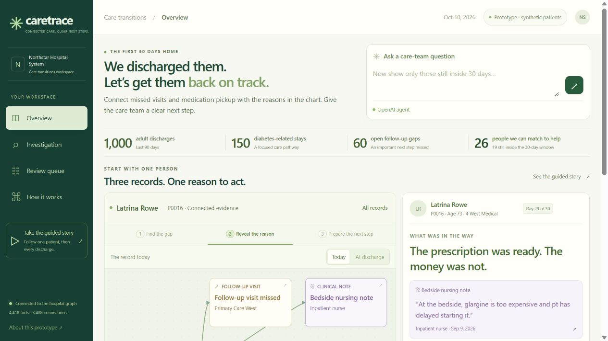
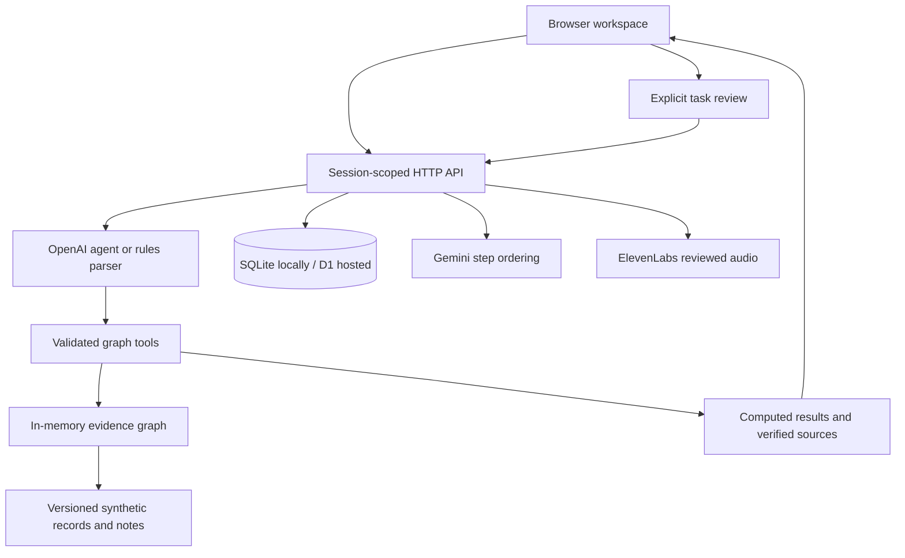

# CareTrace

CareTrace is a hospital care transitions workspace that connects missed follow-up visits and uncollected medication to the reasons documented in clinical notes. A care-team question leads to a counted group of patients, the original supporting evidence, and a proposed task for someone to review.

[Open the web app](https://caretrace.us/) · [Take the guided story](https://caretrace.us/story.html) · [Presenter guide](DEMO.md)

The public demo opens without a login. It uses fictional patients and a fixed reference date of **October 10, 2026**. You can investigate records and try the review workflow without changing another visitor's work. Live AI features depend on the configured services and their shared usage budget.



## Why we built it

A missed appointment tells the team what happened. It often leaves them looking elsewhere for the reason. The clinic has the visit status, the pharmacy has the pickup record, and a bedside nurse may already have written that the patient has no reliable ride.

CareTrace brings those facts into one view. It is designed around the work of care transitions nurses, outpatient pharmacists, social workers, dietitians and diabetes educators: find the missed step, check the evidence, identify the responsible role, and prepare work for review.

Mavis Labadie, the featured fictional patient, illustrates the problem. She left the hospital on September 26. Her October 6 Endocrinology Clinic visit was missed, and her new insulin glargine was not collected. A nursing note written before discharge already documented the transportation difficulty. CareTrace connects the dated records to that sentence and suggests a transport-support task for the care transitions nurse.

## Try the main workflow

1. Open **Overview** and follow the featured patient through **Find the gap**, **Reveal the reason** and **Prepare the next step**. Select a graph card or quoted note to open its source, author and date.
2. Ask **“Which discharged patients have a follow-up gap and a documented barrier?”** The current extracted graph returns **26 patients**. The investigation shows the applied filters, individual patients, citations and executed tool calls.
3. Continue with **“Only those still inside 30 days.”** The result narrows to **19**. Other supported questions can combine age, hospital unit, medication pickup and barrier types. Everyday wording such as **“Who didn’t come?”** selects recorded missed appointments across all discharges. **“Who completed their follow-up?”** and **“Who did not collect their medication?”** use the appointment and medication records directly. A patient name or ID can open an individual record. These questions do not silently require diabetes, an open gap or a documented barrier unless you ask for those conditions.
4. Open a patient's evidence and switch between **Today** and **At discharge**. The earlier view hides outcomes and notes that were not yet available. Return to Today to prepare a task.
5. Choose **Prepare care-team task**, read the proposed action and evidence, and approve it in **Review queue**. Approved work can be marked completed. Reloading preserves the task in this browser's server session.
6. If the services are configured, prepare a **Gemini care brief** to order the patient's documented next steps. An approved or completed task also offers **Listen to this approved brief**, with an exact-text preview before ElevenLabs audio generation.

The [guided story](https://caretrace.us/story.html) is a separate nine-screen presentation with 15 prepared question routes. It explains the same evidence model at a controlled pace. Its calculations and simulations run in browser memory; changes there do not update the live review queue.

## What the workspace does

### Overview and investigations

Overview presents the discharge funnel and groups patients by their primary next step. The fixed dataset contains 1,000 adult discharges, including 150 diabetes-related admissions. Of those, 60 meet the demonstration's follow-up rule and 26 have a detected current barrier. The remaining 34 stay in standard follow-up.

The follow-up rule is explicit: at least 14 days have passed since a diabetes-related discharge, and either follow-up was not completed within 14 days or a newly started discharge medication was not picked up within three days. These are simplified demonstration rules, documented in [the ontology](dist/ontology.js).

An investigation can filter and compare patient groups, inspect individual records, and export its result as JSON. Saved investigations retain the question, filters, count and sources. The count is computed by the graph service from matching records. A language model does not estimate it.

### Patient graph and original evidence

The graph connects patients, admissions, conditions, laboratory results, medications, appointments, clinical notes, follow-up gaps, barriers and actions. Selecting a visible fact opens its underlying record or exact note sentence. Source IDs remain attached to the evidence so a reviewer can check where a conclusion came from.

The note reader detects four types of difficulty: transportation, cost, food insecurity and health literacy. Each type has a defined care-team role and an allowed action template. For example, a cost-related medication task goes to the outpatient pharmacist; a transportation task goes to the care transitions nurse. These mappings are inspectable application rules.

Patients can have more than one barrier. The primary groups contain eight transportation, eleven cost, four food and three health-literacy cases. A transportation filter returns nine patients because one patient has transportation difficulty alongside a primary cost barrier. This explains why an individual filter can differ from the primary grouping shown on Overview.

### Historical views and what-if calculations

The discharge-day view reconstructs the facts available on that date. A future missed visit appears as a scheduled visit, and a later note is unavailable. This lets a reviewer examine what the team could have known earlier.

**What if we resolve this?** temporarily removes one current barrier for one named patient and recomputes the relevant group. Removing Mavis's transportation barrier changes the main group from 26 to 25. The calculation uses a copy of the graph and leaves the source records intact. It does not predict whether a ride would prevent a missed appointment or a later admission.

### Task review and audio

A task contains the patient, proposed action, responsible role and supporting evidence. Its states are **draft → approved → completed**. A draft cannot be completed directly; an approved task can return to draft for further review. Preparing the same patient-and-barrier task twice returns the existing task. Concurrent edits are checked to avoid overwriting a newer review state.

Gemini briefs can include barrier-support, missed-visit and medication-pickup steps. The barrier-support steps can be prepared as review tasks; the other steps remain part of the brief for the team to consider.

ElevenLabs reads the approved server-owned task text aloud. The user sees that exact text before generating an MP3 and can play or download the result. Approval and completion are demo queue states: they do not send messages, contact a patient, book transportation, create orders or update hospital records.

## How the AI services are used

| Service                                 | Role in CareTrace                                                               | Application checks                                                                                                                                  |
| --------------------------------------- | ------------------------------------------------------------------------------- | --------------------------------------------------------------------------------------------------------------------------------------------------- |
| OpenAI, default `gpt-4.1-mini`          | Uses the Responses API to choose graph tools for a question and its follow-ups. | Strict function schemas, validated arguments, bounded execution, verified source selections and server-computed final facts.                        |
| Gemini, default `gemini-3.1-flash-lite` | Orders a patient's existing, evidence-linked care-team steps.                   | Every allowed step ID must appear exactly once. Missing, duplicate or invented IDs are rejected; original action wording and sources are preserved. |
| ElevenLabs, default `eleven_flash_v2_5` | Produces speech from a reviewed task's exact text.                              | Session ownership and review state are checked, including after generation. Requests have a service timeout and a 2 MB audio limit.                 |

The OpenAI agent has six tools:

| Tool                  | Purpose                                                                       |
| --------------------- | ----------------------------------------------------------------------------- |
| `describe_graph`      | Read the actual graph definitions, available filters and hospital units.      |
| `query_patients`      | Compute a patient group, count and result fingerprint from validated filters. |
| `inspect_patient`     | Examine a qualifying patient's connected records and barriers.                |
| `read_source`         | Open a real source row or note returned by the graph.                         |
| `compare_cohorts`     | Calculate counts and overlap between two filtered groups.                     |
| `simulate_resolution` | Recompute a group after temporarily removing one patient's current barrier.   |

The agent must read the graph definitions first. For a nonempty answer, it must inspect a qualifying patient and read supporting evidence before completing the investigation. Clinical-note text is supplied as evidence rather than as agent instructions. The available tools do not expose secrets or execute arbitrary code, and the server supplies calculated counts.

**How it works** exposes the versioned system prompt and tool schemas. The investigation trace shows operations that actually executed, their arguments, returned facts and durations. It does not expose private model reasoning.

Without an OpenAI key, the app starts in clearly labeled **rules mode**. A separate parser handles supported question combinations and follow-ups. Unsupported requests return an explanation. An AI request that fails produces an error and an explicit option to try rules mode.

## Architecture



The browser uses plain JavaScript, HTML and CSS. The active graph view uses interactive HTML cards connected by SVG paths. Node.js serves the local HTTP API and stores saved work through its built-in SQLite support. The hosted build runs the same API in a Cloudflare Worker with D1 persistence, published through Sites at [caretrace.us](https://caretrace.us/).

The evidence graph is constructed in server memory from versioned JavaScript data. SQLite and D1 store sessions, investigations, tasks and usage reservations. Neo4j is not required. Drizzle defines the database schema and migration history; esbuild packages the Worker and its allowlisted browser assets. Cytoscape remains a dependency of an earlier graph implementation and is not the active workspace renderer.

API routes are grouped under `/api/v1`. Status and overview routes expose execution mode and computed totals; investigation routes stream tool events and save results; patient and source routes return dated evidence; task routes create drafts and record review transitions. [The architecture document](docs/LIVE_WORKSPACE.md) describes the request path and core endpoints. [The API implementation](backend/live-api.js) also contains the Gemini brief and task-audio routes.

## Data and measured accuracy

Synthetic identities and active problem fields were imported from the [official Synthea COVID-19 sample](https://synthetichealth.github.io/downloads.html). Hospital admissions, dates, test results, prescriptions, pickup records, appointments and clinical notes were authored as reproducible demonstration scenarios. They should not be interpreted as original Synthea hospital stays or real patient histories.

Data reference: Walonoski et al., _Synthea Novel coronavirus (COVID-19) model and synthetic data set_, Intelligence-Based Medicine, 2020. [DOI: 10.1016/j.ibmed.2020.100007](https://doi.org/10.1016/j.ibmed.2020.100007).

The checked-in dataset contains **1,000 fictional adults and 600 clinical notes**, with scenario seed `20261010`. [Dataset provenance](dist/pilot-data.js) records the source URL, archive digest, imported fields and adaptation. A separately authored synthetic answer key is used to measure extraction.

The active text-pattern reader, version `2026-10-10.2`, and the preserved guided reader both score:

| Measure         | Result |
| --------------- | ------ |
| True positives  | 49     |
| False positives | 6      |
| False negatives | 5      |
| Precision       | 89.09% |
| Recall          | 90.74% |

The main extracted group contains 26 patients; the separate answer key contains 27. P0025 is missed, and P0024's additional food difficulty is also missed. Six context errors remain outside the main follow-up group. Counts are exact for the graph that extraction produced, while the extracted evidence still has these known mistakes.

These measurements apply to the project's synthetic labels. They do not establish clinical accuracy. The live reader uses text patterns; the trained Naive Bayes model retained elsewhere in the repository belongs to an earlier evaluation and is not used by the active workspace.

## Run locally

Install **Node.js 24 or newer**, clone this repository, and run:

```sh
git clone https://github.com/sadraaliproject/Hackathon-26.git
cd Hackathon-26
npm ci
npm start
```

Open [localhost:4173](http://localhost:4173). No API key or separate database installation is needed for rules mode. The server initializes the active SQLite database at `data/careweave-live.sqlite`, which is ignored by Git. That internal filename is retained from the earlier project name to preserve existing local work. The VS Code **CareTrace: Run and debug** configuration starts the same server.

To enable live AI features, copy `.env.example` to `.env` in the repository root and supply your own service keys. In PowerShell:

```powershell
Copy-Item .env.example .env
```

On macOS or Linux, use `cp .env.example .env`. The example contains blank credentials. Keep `.env` local and restart `npm start` after changing it.

| Setting               | Purpose                                                        |
| --------------------- | -------------------------------------------------------------- |
| `PORT`                | Local HTTP port; defaults to `4173`.                           |
| `OPENAI_API_KEY`      | Enables model-driven investigations.                           |
| `OPENAI_MODEL`        | Investigation model; defaults to `gpt-4.1-mini`.               |
| `GEMINI_API_KEY`      | Enables Gemini care-brief ordering.                            |
| `GEMINI_MODEL`        | Brief model; defaults to `gemini-3.1-flash-lite`.              |
| `ELEVENLABS_API_KEY`  | Enables reviewed-task speech generation.                       |
| `ELEVENLABS_VOICE_ID` | Voice available to the ElevenLabs account. Required for audio. |
| `ELEVENLABS_MODEL`    | Speech model; defaults to `eleven_flash_v2_5`.                 |

Hosted settings are separate protected server secrets. A local `.env` file is not uploaded automatically. The Worker requires a D1 database bound as `DB` and the deployment migrations; see [Worker entry](worker/index.js), [hosting configuration](.openai/hosting.json) and [live schema migration](drizzle/0002_live_workspace.sql). `npm run build` creates `dist/server/index.js`; it builds the deployment artifact without publishing it. A static upload alone cannot run the active API.

## Saved work and operating limits

Each browser receives an opaque HttpOnly, SameSite session cookie, marked Secure over HTTPS. The server checks session ownership when reading or changing investigations and tasks. Mutation routes check the request origin, and private files such as `.env`, server modules and saved databases are excluded from browser assets.

Sessions last 30 days, with the latest 20 investigations and up to 100 tasks retained per session. Clearing cookies or switching browsers creates a different workspace. This demo does not include staff accounts, shared team queues or cross-device identity.

Investigations, Gemini briefs and ElevenLabs audio share an overall limit of 60 requests per session per hour and 500 globally per day. Live AI requests also share a budget of 12 per session per hour and 50 globally per day across those services. Reservations are stored and checked atomically. An investigation has a 45-second API timeout; Gemini and ElevenLabs service requests have 25-second timeouts.

For a fresh local review queue, use a new browser session or clear this site's cookies. The retained `demo:reset` script targets an earlier database and does not reset the active workspace.

## Verify the build

From the repository root:

```sh
npm run check
npm test
npm run build
node scripts/verify-worker.js
```

| Check                           | What it establishes                                                                                                                                                    |
| ------------------------------- | ---------------------------------------------------------------------------------------------------------------------------------------------------------------------- |
| `npm run check`                 | JavaScript syntax and the project's hospital-language audit. Applied historical migrations are checked separately and remain unchanged.                                |
| `npm test`                      | Graph calculations, reader behavior, dated sources, agent orchestration, browser handlers, HTTP behavior, session isolation, task transitions and storage regressions. |
| `npm run build`                 | Production Worker compilation and browser-asset packaging.                                                                                                             |
| `node scripts/verify-worker.js` | The compiled Worker, actual migrations and SQLite-backed D1 adapter: queries, task persistence, allowed assets and visitor isolation.                                  |
| `npm run verify:pilot`          | Regenerates the preserved guided-story evaluation report. It does not measure the active reader; active-reader measurements are asserted by its tests.                 |

The October 11 question-handling update passed **198 automated tests** and the production bundle checks. Separate bounded requests verified live OpenAI investigations, Gemini ordering and playable ElevenLabs MP3 output. Desktop, mobile and keyboard flows were also checked. [The release checklist](docs/RELEASE_CHECKLIST.md) records the scope, corrections and remaining limitations.

Model failure-path tests use mocked HTTP responses. Passing them does not prove that a newly supplied key has account access, quota or permission to use a selected model. Live service checks remain necessary after changing accounts or configuration.

## Repository guide

| Location                                                                                                                 | Responsibility                                                                                 |
| ------------------------------------------------------------------------------------------------------------------------ | ---------------------------------------------------------------------------------------------- |
| [Workspace](dist/workspace.js), [styles](dist/workspace.css), [graph view](dist/workspace-graph.js)                      | Overview, investigation controls, evidence dialogs and review queue.                           |
| [Local server](server.js), [Worker](worker/index.js)                                                                     | Runtime entry points and HTTP delivery.                                                        |
| [Live API](backend/live-api.js)                                                                                          | Validated routes, sessions, budgets and review operations.                                     |
| [Agent](backend/live-agent.js), [prompt and tools](backend/prompts/investigator.js)                                      | OpenAI orchestration, supported rules parsing and inspectable tool contract.                   |
| [Graph service](backend/live-graph.js), [reader](backend/live-reader.js), [ontology](dist/ontology.js)                   | Patient filtering, source validation, note extraction and permitted actions.                   |
| [Gemini brief](backend/gemini-brief.js), [task audio](backend/task-audio.js)                                             | Validated step ordering and reviewed-text speech.                                              |
| [Store](backend/live-store.js), [SQLite adapter](backend/live-sqlite.js), [schema](db/schema.js), [migrations](drizzle/) | Durable local and hosted workspace state.                                                      |
| [Data](dist/pilot-data.js), [labels](dist/pilot-labels.js), [generation script](scripts/generate-pilot-data.js)          | Reproducible fictional records, provenance and separately stored expected labels.              |
| [Guided story](dist/story.html), [story controller](dist/pilot-app.js), [support calculations](dist/pilot-support.js)    | Prepared presentation, graph-versus-search comparison, TF-IDF retrieval and PCA visualization. |
| [Tests](tests/), [scripts](scripts/)                                                                                     | Regression coverage, checks, data preparation and packaging.                                   |

Earlier integration modules and their regression tests remain in the repository for reference. They are not served as the active workspace. The [guided-story evaluation](docs/ENHANCEMENT_REPORT.md) describes that presentation's scope; the [live architecture](docs/LIVE_WORKSPACE.md) and [release checklist](docs/RELEASE_CHECKLIST.md) describe the current app. The older article draft and screenshot-montage video are historical artifacts, not the current submission walkthrough.

## Hacklanta 2026

**Main track:** AI/ML. **Selected side challenges:** ElevenLabs, Gemini and GoDaddy Registry.

ElevenLabs supplies reviewed-task speech; Gemini orders care-team steps using the graph's evidence. The GoDaddy Registry hackathon domain offer supplied **caretrace.us**, the public address for the hosted app. OpenAI is also used for investigations, as described above.

Development used Codex for implementation, debugging, tests and documentation. The guided story's prepared plans and explanations were authored with language-model assistance during development. Third-party libraries and public synthetic data are identified in this README and the dependency manifests.

## Current limitations and next work

CareTrace is a working hackathon prototype with fictional data. It has no connection to a real hospital's records, appointment system, pharmacy, transport service or messaging system. The fixed snapshot does not ingest new clinical events, and approving a task does not resolve the underlying barrier.

The next work is to test the workflow with the intended care-team roles, improve extraction against a separate evaluation set, and establish staff identity and shared work ownership before any real hospital use. Operational monitoring, backup-and-restore rehearsal, sustained load testing and clinical review would also be needed. The current checks do not include a formal penetration test or a clinical study.
