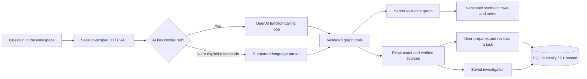

# Live workspace architecture

The new workspace keeps the graph central while moving queries, evidence validation, saved investigations, and task review to the server. The original prepared presentation remains available at `/story.html`.

## Request path

## Agent contract

The inspectable instructions live in `backend/prompts/investigator.js`, versioned by `LIVE_PROMPT_VERSION`. `/api/v1/agent` returns those instructions and the actual tool schemas. The application does not display private model reasoning; its event stream reports validated tool calls, measured results, and durations.

The agent must read the graph contract, query it, inspect a qualifying patient, and read a real source before completing a nonempty result. Its tools support exact cohort queries, patient inspection, source reading, group comparison, and reversible barrier simulations. It cannot send messages or approve tasks. Strict JSON schemas constrain arguments; server validation and budgets still apply. The server renders the final factual answer from executed results and verifies patient/source selections.

The OpenAI implementation follows the [official function-calling guide](https://developers.openai.com/api/docs/guides/function-calling): function outputs are returned to the model until it completes or reaches a limit. Server requests use `store: false`; credentials stay in local environment files or hosted secrets. The configured model is explicit rather than inferred from the interface.

No key means a clearly labeled rules engine. It accepts supported field combinations and follow-ups, rather than choosing a nearest scripted question. A failed model call produces an error and an explicit option to try rules mode. Connecting a key requires a real API smoke test; fake HTTP responses in tests only verify orchestration and error handling.

## Data and graph

The immutable dataset contains 1,000 fictional adult discharges and 600 notes. The server constructs nodes and typed edges from those files, including pointers back to the source rows. Counts traverse the graph's stored relationships using a validated filter contract. The graph is an in-memory JavaScript implementation, not a hosted Neo4j instance.

The live text-pattern reader is separately versioned at `2026-10-10.2`, with fixes for explicit resolution and independent clauses. The guided story retains the frozen reader and its original evaluation. Live note evaluation against the separate synthetic answer key measures 49 true positives, 6 false positives and 5 false negatives, or 89.09% precision and 90.74% recall. The main extracted group has 26 patients, while the independent authored answer key has 27. Model-driven investigation does not remove these extraction errors.

The snapshot date is October 10, 2026. Rewind reconstructs the available dated facts. What-if runs on a fresh graph copy and returns an explicit simulated result; it never changes the source dataset or asserts a real medical outcome.

## Persistence and isolation

The additive `0002_live_workspace.sql` migration adds session, investigation, task, and usage tables. Existing tables and migration history remain intact. Local SQLite initializes the new tables at startup; hosted D1 uses deployment migrations, with no request-time schema changes.

Each visitor receives an opaque, random HttpOnly cookie scoped to `/api/v1`. Secure cookies are used over HTTPS. Same-site cookies and origin checks protect mutation routes. All saved run and task lookups include the session identifier. Clearing cookies or using a different browser creates a different workspace; there is no cross-device staff account in this demonstration.

Sessions expire after 30 days. Run history is bounded to the latest 20 entries and tasks to 100 per session. Usage reservations are checked atomically; model and general-query budgets are separate. Expired records are cleaned through their session relationship. Private configuration, saved databases, and server modules are excluded from the browser asset allowlist. The guided story intentionally serves its fictional dataset to the browser.

Tasks move from draft to approved to completed, with optimistic concurrency checks. A duplicate preparation for the same patient and barrier returns the existing task. Approval is a demonstration state change only. Completing a task does not manufacture a completed appointment, medication pickup, or resolved clinical barrier.

## Endpoints

| Endpoint                                   | Purpose                                                           |
| ------------------------------------------ | ----------------------------------------------------------------- |
| `GET /api/v1/status`                       | Execution mode, storage type, snapshot date, limits               |
| `GET /api/v1/overview`                     | Computed funnel, graph totals, featured patient and action groups |
| `POST /api/v1/investigate`                 | Stream actual tool events, then a persisted result                |
| `GET /api/v1/runs` and `/runs/:id`         | This session's saved investigations                               |
| `GET /api/v1/patients/:id?asOf=YYYY-MM-DD` | Patient facts and dated graph                                     |
| `GET /api/v1/sources/:id?asOf=YYYY-MM-DD`  | Source row or note, masked to the same date as the patient graph  |
| `GET /api/v1/agent`                        | Versioned system prompt and tool schemas                          |
| `POST /api/v1/what-if`                     | Isolated barrier-removal calculation                              |
| `GET/POST /api/v1/tasks`                   | Session queue and evidence-linked draft creation                  |
| `PATCH /api/v1/tasks/:id`                  | Explicit review status transition                                 |

The older unversioned mutation APIs remain disabled so the archived implementation cannot modify the new workspace accidentally.

## Verification boundaries

The CareTrace audit passes 195 automated tests, including new regressions for stale browser responses, historical source visibility, wrong-barrier simulations and unsupported inverse questions. Current browser and deployment checks are recorded in [the release checklist](RELEASE_CHECKLIST.md).

Unit and integration checks use real synthetic data, real SQLite persistence, the actual D1 SQL adapter, and a mocked OpenAI HTTP transport. The bundle check serves every allowed asset, executes a streamed graph investigation, saves and approves a task, and checks visitor separation. Browser review covers the story and public-facing controls at desktop and mobile sizes.

OpenAI, Gemini and ElevenLabs are configured as server secrets. Bounded live requests verify actual account connectivity separately from mocked failure-path tests. This app is a hackathon demonstration; these checks do not validate clinical decisions or hospital deployment.
